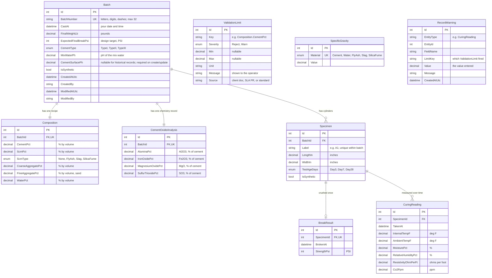

# Data Schema — Concrete Batch Analysis System

**Status:** Approved (M1-02) · **Owner:** Tyler · **Approver:** Amelia
**Last updated:** 2026-10-14

This file is the single source of truth for every piece of data the app stores. The names here are the exact names used
in the C# classes, the API, and the UI bindings. If you need a field that isn't here, don't invent one: open a PR
against this file first.

---

## 1. The big picture

- A **Batch** is one pour of concrete.
- Every batch has exactly one **Composition** (the mix recipe) and exactly one **CementOxideAnalysis** (cement chemistry
  from the supplier's certificate).
- A batch has many **Specimens** (test cylinders).
- Each specimen is crushed once, so it has **zero or one** **BreakResult**.
- Each specimen has many **CuringReadings** taken over time.
- Three supporting tables hold settings and flags:
    - **ValidationLimit**: allowed ranges.
    - **SpecificGravity**: material densities, used for the water-to-cement ratio.
    - **RecordWarning**: values that were saved but flagged as unusual.

[Link to ER Diagram](schema-ERD-draft.png)
---

## 2. Conventions (apply to every table)

| Rule                   | Detail                                                                                                                                                                                                                                  |
|------------------------|-----------------------------------------------------------------------------------------------------------------------------------------------------------------------------------------------------------------------------------------|
| Primary keys           | `Id`, integer, auto-increment                                                                                                                                                                                                           |
| Foreign keys           | `<Parent>Id`, e.g. `BatchId`                                                                                                                                                                                                            |
| Audit fields (FR-22)   | Every table except `SpecificGravity` has `CreatedAtUtc`, `CreatedBy`, `ModifiedAtUtc?`, `ModifiedBy?`. Set automatically by the save interceptor (M1-22); never set by hand. Shown on `Batch` in the diagram only, to keep it readable. |
| Times                  | Stored in UTC; displayed in the workstation's local time                                                                                                                                                                                |
| Units (NFR-5)          | One unit per field, in the field name where possible (`Lb`, `In`, `Psi`, `F`, `Pct`, `Ppm`). Convert only in `Domain.Units`.                                                                                                            |
| Percentages            | Stored as numbers from 0 to 100 (`12.5` means 12.5%), not fractions                                                                                                                                                                     |
| Decimals               | Max 2 decimal places unless noted. SQLite has no native decimal; stored via EF value converter (M1-21).                                                                                                                                 |
| Synthetic data (FR-20) | `IsSynthetic` lives on `Batch` and `Specimen`. Break results and readings inherit it from their specimen.                                                                                                                               |
| Deleting               | No deletes in M1.                                                                                                                                                                                                                       |

---

## 3. Field dictionary

"Req" means required. "Validation" names the `ValidationLimit` keys that apply (see section 4). Every rule is enforced
in both the UI and the API (NFR-6).

### Batch — one pour of concrete

| Field                   | Type       | Unit | Req  | Validation / rule                                                      | FR                |
|-------------------------|------------|------|------|------------------------------------------------------------------------|-------------------|
| `Id`                    | int        | —    | auto | Primary key                                                            | —                 |
| `BatchNumber`           | string(32) | —    | Yes  | Trimmed; letters, digits, dashes only; unique, case-insensitive        | FR-1, FR-9        |
| `CastAt`                | datetime   | —    | Yes  | Not in the future                                                      | FR-1              |
| `FinalWeightLb`         | decimal    | lb   | Yes  | **Reject outside 10-40**, **Warn outside 20-30**, max 2 decimals       | FR-1, Decision 11 |
| `ExpectedFinalBreakPsi` | int        | PSI  | Yes  | `Batch.ExpectedFinalBreakPsi` (**Reject** outside 3,000–10,000)        | FR-5, Decision 3  |
| `CementType`            | enum       | —    | Yes  | `TypeI`, `TypeII`, `TypeIII`                                           | A-4               |
| `MixWaterPh`            | decimal    | —    | Yes  | **Reject outside 1–9**, message states range; **Warn outside 7.0–7.5** | FR-7, Decision 4  |
| `IsSynthetic`           | bool       | —    | Yes  | Defaults to `false`; seeder sets `true`                                | FR-20             |
| `CementSurfacePh` | decimal? | — | Yes* | Max 2 decimals; Reject outside 0–14; Warn outside 7.1–8.0 | FR-7 extended, NFR-6 |

\*Required when creating or editing a batch. Historical records may be null.

### Composition — the mix recipe (1 per batch)

Percentages are **by absolute volume** (client decision 1). The composition must be saved in the same transaction as its
batch.

| Field                | Type    | Unit  | Req  | Validation / rule                                                                                                  | FR          |
|----------------------|---------|-------|------|--------------------------------------------------------------------------------------------------------------------|-------------|
| `Id`                 | int     | —     | auto | Primary key                                                                                                        | —           |
| `BatchId`            | int     | —     | Yes  | FK → Batch; unique (one recipe per batch)                                                                          | FR-2        |
| `CementPct`          | decimal | % vol | Yes  | `Composition.CementPct` (10–15)                                                                                    | FR-2.1      |
| `ScmPct`             | decimal | % vol | Yes  | 0–100; enter 0 if none                                                                                             | FR-2        |
| `ScmType`            | enum    | —     | Yes  | `None`, `FlyAsh`, `Slag`, `SilicaFume`. Must be `None` when `ScmPct` = 0 and must not be `None` when `ScmPct` > 0. | Decision 1a |
| `CoarseAggregatePct` | decimal | % vol | Yes  | `Composition.CoarseAggregatePct` (40–55)                                                                           | FR-2.1      |
| `FineAggregatePct`   | decimal | % vol | Yes  | `Composition.FineAggregatePct` (25–30). Sand and fine aggregate are the same field.                                | FR-2.1      |
| `WaterPct`           | decimal | % vol | Yes  | `Composition.WaterPct` (15–20)                                                                                     | FR-2.1      |

**Calculated values** (never stored, computed in `Domain`):

| Name               | Formula                                                                                                                                                | Rule                   | FR                |
|--------------------|--------------------------------------------------------------------------------------------------------------------------------------------------------|------------------------|-------------------|
| `TotalPct`         | Cement + SCM + Coarse + Fine + Water                                                                                                                   | Reject if > 100        | Decision 2        |
| `AirOtherPct`      | 100 − `TotalPct`                                                                                                                                       | Display only           | Decision 2        |
| `WaterCementRatio` | (Water × 1.00) ÷ (Cement × SG_cement + SCM × SG_scmType). SG = `SpecificGravity.Value`. `null` if the denominator is 0. Technically w/cm when SCM > 0. | Warn outside 0.40–0.60 | FR-8, Decision 1a |

Worked example: cement 12, water 18, SCM 0 → 18 ÷ (12 × 3.15) = **0.48**.

### CementOxideAnalysis — cement chemistry (1 per batch)

These values come from the cement supplier's mill certificate. They are percentages **of the cement**, not of the batch,
and are never added to the composition total (FR-3).

| Field               | Type    | Unit        | Req  | Validation / rule                    | FR               |
|---------------------|---------|-------------|------|--------------------------------------|------------------|
| `Id`                | int     | —           | auto | Primary key                          | —                |
| `BatchId`           | int     | —           | Yes  | FK → Batch; unique                   | FR-3             |
| `AluminaPct`        | decimal | % of cement | Yes  | Warn 3.0–7.5; Reject 0–100           | FR-3             |
| `IronOxidePct`      | decimal | % of cement | Yes  | Warn 0.5–6.0; Reject 0–100           | FR-3             |
| `MagnesiumOxidePct` | decimal | % of cement | Yes  | Warn 0.1–4.0; **Reject > 6.0**       | FR-3             |
| `SulfurTrioxidePct` | decimal | % of cement | Yes  | Warn 1.3–3.0; **Reject > 4.5**       | FR-3, Decision 7 |

### Specimen — one test cylinder

| Field         | Type       | Unit | Req  | Validation / rule                                              | FR    |
|---------------|------------|------|------|----------------------------------------------------------------|-------|
| `Id`          | int        | —    | auto | Primary key                                                    | —     |
| `BatchId`     | int        | —    | Yes  | FK → Batch                                                     | FR-10 |
| `Label`       | string(20) | —    | Yes  | Operator's cylinder ID, e.g. `A1`; unique within its batch     | FR-10 |
| `LengthIn`    | decimal    | in   | Yes  | > 0 and ≤ 12.00; more than 2 decimals is rejected, not rounded | FR-4  |
| `WidthIn`     | decimal    | in   | Yes  | > 0 and ≤ 6.00; same precision rule                            | FR-4  |
| `TestAgeDays` | enum       | days | Yes  | `Day3` (3), `Day7` (7), `Day28` (28)                           | FR-5  |
| `IsSynthetic` | bool       | —    | Yes  | Matches its batch                                              | FR-20 |

### BreakResult — the crush test (0 or 1 per specimen)

| Field         | Type     | Unit | Req  | Validation / rule                                                                  | FR               |
|---------------|----------|------|------|------------------------------------------------------------------------------------|------------------|
| `Id`          | int      | —    | auto | Primary key                                                                        | —                |
| `SpecimenId`  | int      | —    | Yes  | FK → Specimen; **unique** (a second result is rejected)                            | FR-5             |
| `BrokenAt`    | datetime | —    | Yes  | On or after the batch's `CastAt`; not in the future                                | FR-5             |
| `StrengthPsi` | int      | PSI  | Yes  | **Reject** outside 1–10,000; **Warn** below 3,000 (failing breaks must still save) | FR-5, Decision 3 |

### CuringReading — measurements over time (many per specimen)

| Field                 | Type     | Unit    | Req  | Validation / rule                                   | FR          |
|-----------------------|----------|---------|------|-----------------------------------------------------|-------------|
| `Id`                  | int      | —       | auto | Primary key                                         | —           |
| `SpecimenId`          | int      | —       | Yes  | FK → Specimen                                       | FR-6        |
| `TakenAt`             | datetime | —       | Yes  | On or after the batch's `CastAt`; not in the future | FR-6, FR-13 |
| `InternalTempF`       | decimal  | °F      | Yes  | `Curing.InternalTempF` (plausible range, 1 decimal) | FR-6        |
| `AmbientTempF`        | decimal  | °F      | Yes  | Plausible range; **Warn outside 60–80**             | FR-6        |
| `MoisturePct`         | decimal  | %       | Yes  | 0–100                                               | FR-6        |
| `RelativeHumidityPct` | decimal  | %       | Yes  | 0–100                                               | FR-6        |
| `ResistivityOhmPerFt` | decimal  | ohms/ft | Yes  | > 0                                                 | FR-6        |
| `Co2Ppm`              | decimal  | ppm     | Yes  | ≥ 0                                                 | FR-6        |

### ValidationLimit — every allowed range (config)

| Field      | Type        | Req  | Notes                                                                          |
|------------|-------------|------|--------------------------------------------------------------------------------|
| `Id`       | int         | auto | Primary key                                                                    |
| `Key`      | string(64)  | Yes  | `<Entity>.<Field>`, e.g. `Composition.CementPct`. `(Key, Severity)` is unique. |
| `Severity` | enum        | Yes  | `Reject` blocks the save; `Warn` saves and creates a `RecordWarning`           |
| `Min`      | decimal?    | No   | Inclusive. Null means no lower bound.                                          |
| `Max`      | decimal?    | No   | Inclusive. Null means no upper bound.                                          |
| `Unit`     | string(16)  | Yes  | For display, e.g. `%`, `°F`, `PSI`                                             |
| `Message`  | string(200) | Yes  | Shown to the operator. Must state the range.                                   |
| `Source`   | string(100) | Yes  | Where the number came from                                                     |

### SpecificGravity — material density (config)

| Field      | Type    | Req  | Notes                                                     |
|------------|---------|------|-----------------------------------------------------------|
| `Id`       | int     | auto | Primary key                                               |
| `Material` | enum    | Yes  | Unique. `Cement`, `Water`, `FlyAsh`, `Slag`, `SilicaFume` |
| `Value`    | decimal | Yes  | > 0                                                       |

### RecordWarning — values saved but flagged

| Field          | Type        | Req  | Notes                                                  |
|----------------|-------------|------|--------------------------------------------------------|
| `Id`           | int         | auto | Primary key                                            |
| `EntityType`   | string(40)  | Yes  | Class name of the flagged record, e.g. `CuringReading` |
| `EntityId`     | int         | Yes  | Its `Id`                                               |
| `FieldName`    | string(64)  | Yes  | Property that triggered it                             |
| `LimitKey`     | string(64)  | Yes  | The `ValidationLimit.Key` that fired                   |
| `Value`        | decimal     | Yes  | The value entered                                      |
| `Message`      | string(200) | Yes  | Copied from the limit when saved                       |
| `CreatedAtUtc` | datetime    | Yes  | When the warning was raised                            |

---

## 4. Default seed values

These rows are loaded on first run (M1-21). Changing them later is a data change, not a code change.

### ValidationLimit

| Key                              | Severity | Min  | Max   | Unit    | Source                                 |
|----------------------------------|----------|------|-------|---------|----------------------------------------|
| `Composition.CementPct`          | Reject   | 10   | 15    | %       | Client doc / FR-2.1                    |
| `Composition.FineAggregatePct`   | Reject   | 25   | 30    | %       | Client doc / FR-2.1                    |
| `Composition.CoarseAggregatePct` | Reject   | 40   | 55    | %       | Client doc / FR-2.1                    |
| `Composition.WaterPct`           | Reject   | 15   | 20    | %       | Client doc / FR-2.1                    |
| `Composition.ScmPct`             | Reject   | 0    | 100   | %       | FR-2                                   |
| `Composition.TotalPct`           | Reject   | —    | 100   | %       | Decision 2 (NRMCA)                     |
| `Composition.WaterCementRatio`   | Warn     | 0.40 | 0.60  | ratio   | Client doc, Hydration                  |
| `Oxide.AluminaPct`               | Warn     | 3.0  | 7.5   | %       | Client doc table                       |
| `Oxide.IronOxidePct`             | Warn     | 0.5  | 6.0   | %       | Client doc table                       |
| `Oxide.MagnesiumOxidePct`        | Warn     | 0.1  | 4.0   | %       | Client doc table                       |
| `Oxide.MagnesiumOxidePct`        | Reject   | 0    | 6.0   | %       | ASTM C150                              |
| `Oxide.SulfurTrioxidePct`        | Warn     | 1.3  | 3.0   | %       | Client doc table                       |
| `Oxide.SulfurTrioxidePct`        | Reject   | 0    | 4.5   | %       | ASTM C150 Table 1 (Type III, C3A > 8%) |
| `Oxide.AluminaPct`               | Reject   | 0    | 100   | %       | FR-3                                   |
| `Oxide.IronOxidePct`             | Reject   | 0    | 100   | %       | FR-3                                   |
| `Specimen.LengthIn`              | Reject   | 0.01 | 12.00 | in      | FR-4                                   |
| `Specimen.WidthIn`               | Reject   | 0.01 | 6.00  | in      | FR-4                                   |
| `Batch.FinalWeightLb`            | Reject   | 10   | 40    | lb      | Client, M1 demo (Oct 9)                |
| `Batch.FinalWeightLb`            | Warn     | 20   | 30    | lb      | Client, M1 demo (Oct 9)                |
| `Batch.ExpectedFinalBreakPsi`    | Reject   | 3000 | 10000 | PSI     | Client doc / FR-5                      |
| `Break.StrengthPsi`              | Reject   | 1    | 10000 | PSI     | Client doc / FR-5, Decision 3          |
| `Break.StrengthPsi`              | Warn     | 3000 | 10000 | PSI     | Client doc / FR-5                      |
| `Batch.MixWaterPh`               | Reject   | 1    | 9     | —       | Client doc / FR-7, Decision 4          |
| `Batch.MixWaterPh`               | Warn     | 7.0  | 7.5   | —       | Client doc ("normal")                  |
| `Batch.CementSurfacePh`          | Reject   | 0    | 14    | —       | Client, M1 demo (Oct 9) |
| `Batch.CementSurfacePh`          | Warn     | 7.1  | 8.0   | —       | Client, M1 demo (Oct 9) |
| `Curing.AmbientTempF`            | Reject   | 0    | 150   | °F      | Plausibility                           |
| `Curing.AmbientTempF`            | Warn     | 60   | 80    | °F      | ASTM C31 initial curing                |
| `Curing.InternalTempF`           | Reject   | 0    | 200   | °F      | Plausibility (heat of hydration)       |
| `Curing.MoisturePct`             | Reject   | 0    | 100   | %       | FR-6                                   |
| `Curing.RelativeHumidityPct`     | Reject   | 0    | 100   | %       | FR-6                                   |
| `Curing.ResistivityOhmPerFt`     | Reject   | 0.01 | —     | ohms/ft | FR-6                                   |
| `Curing.Co2Ppm`                  | Reject   | 0    | —     | ppm     | FR-6                                   |

The two "Plausibility" temperature ranges are our own guardrails against typos (e.g. 720 instead of 72), not client
rules. Adjust them if real data says otherwise.

### SpecificGravity

| Material   | Value | Source                              |
|------------|-------|-------------------------------------|
| Cement     | 3.15  | PCA / Pavement Interactive          |
| Water      | 1.00  | —                                   |
| Slag       | 2.90  | PCA Ch. 3 (range 2.85–2.95)         |
| FlyAsh     | 2.35  | PCA Ch. 3 (range 1.9–2.8, midpoint) |
| SilicaFume | 2.35  | PCA Ch. 3 (range 2.2–2.5, midpoint) |

---

## 5. Open items

- **Batch number format:** no industry standard exists. The rule is letters, digits and dashes, up to 32 characters,
  until Vulcan shows us a real one.
- **Plausibility temperature ranges** (0–150°F ambient, 0–200°F internal) are team guardrails, not client rules. Review
  them when real data arrives.
