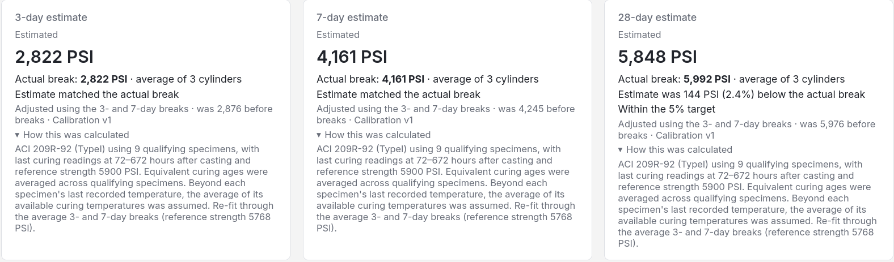
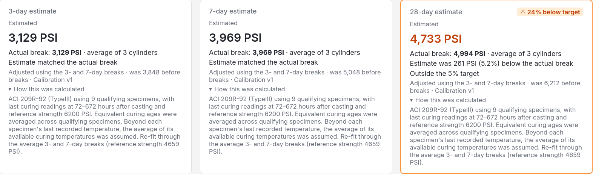
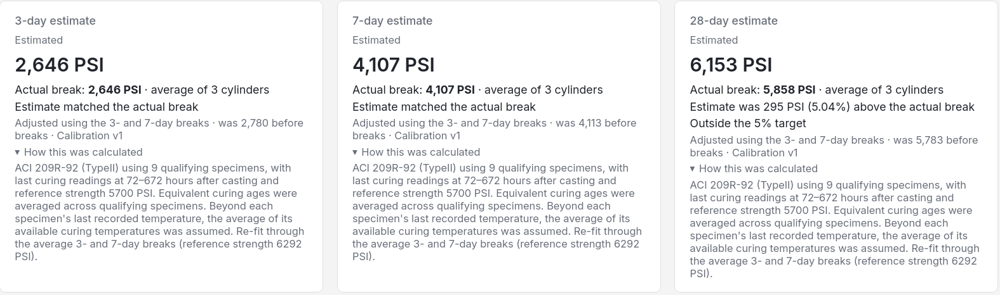
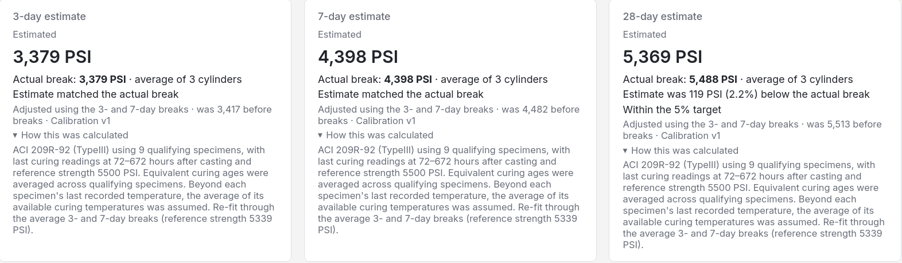

# Validation Report

How strength prediction accuracy was measured, on what data, what was achieved, and what it does and doesn't prove.

> **Synthetic data only.** Every result below comes from the nine fabricated VM-SYN batches. Vulcan Materials did not provide verified break results, so no real batch could be validated this term. Per SLA 1.3, these results do not establish real-world accuracy or reliability of strength estimates.

## Method

Accuracy follows the client's benchmark (client-decisions §14.2): an estimate is accurate when it is **within 5% of the actual average break** at that age. This is separate from the 5% projected-shortfall warning (client-decisions §13), which compares the estimate with the batch's expected final strength rather than a measured break.

For each batch, at 3, 7 and 28 days:

- **Before breaks:** the estimate made from curing data alone, before any breaks were entered (the card's "was X before breaks"). This is the fair test of the model at 3 and 7 days. The adjusted 3- and 7-day estimates are re-fit through those same breaks, so they match them by construction and are not counted as validation.
- **After re-fit (28 days only):** the 28-day estimate after the 3- and 7-day re-fit. This is the number the app shows while waiting for the 28-day break, so it is the one an operator would act on.

Error is `(estimate − actual) / actual`; a positive error means the estimate was high. Actual is the average of the three cylinders at that age.

All estimates use Calibration v1: ACI 209R-92 with Nurse–Saul maturity (14 °F datum, 73.4 °F reference) and the 3- and 7-day re-fit described in ADR-005 and `docs/calculation-method.md`.

## Data

Nine synthetic batches, VM-SYN-001 to VM-SYN-009, each with nine cylinders (three each at 3, 7 and 28 days) and curing readings through the 28-day break (`docs/synthetic-data.md`).

Synthetic data was used because Vulcan Materials did not provide verified break results during the term.

The synthetic breaks are not independent of the model. Each one starts from the same ADR-005 estimate the app uses, then adds made-up effects (cold curing, moisture loss, SCM content) and ±5% scatter per cylinder (`docs/synthetic-data.md`, "How the breaks are generated"). Agreement on the on-track batches is therefore partly circular: it shows the pipeline computes correctly end to end, not that ACI 209R-92 is accurate for Vulcan's mixes.

## Results

| Batch | Scenario | 3-day before breaks | 7-day before breaks | 28-day before breaks | 28-day after re-fit | 28-day within 5% (after re-fit)? |
|---|---|---|---|---|---|---|
| VM-SYN-001 | On track | 3,021 vs 3,007 (+0.5%) | 4,456 vs 4,434 (+0.5%) | 6,277 vs 6,396 (−1.9%) | 6,242 vs 6,396 (−2.4%) | Yes |
| VM-SYN-002 | Cold-cured | 2,012 vs 1,942 (+3.6%) | 3,202 vs 3,098 (+3.4%) | 5,178 vs 4,937 (+4.9%) | 5,028 vs 4,937 (+1.8%) | Yes |
| VM-SYN-003 | Moisture loss | 3,725 vs 3,022 (+23.3%) | 4,874 vs 3,812 (+27.9%) | 6,005 vs 4,793 (+25.3%) | 4,535 vs 4,793 (−5.4%) | No |
| VM-SYN-004 | On track | 2,876 vs 2,822 (+1.9%) | 4,245 vs 4,161 (+2.0%) | 5,976 vs 5,992 (−0.3%) | 5,848 vs 5,992 (−2.4%) | Yes |
| VM-SYN-005 | On track | 2,776 vs 2,794 (−0.6%) | 4,105 vs 4,221 (−2.7%) | 5,777 vs 5,808 (−0.5%) | 6,106 vs 5,808 (+5.1%) | No |
| VM-SYN-006 | High w/c | 3,848 vs 3,129 (+23.0%) | 5,048 vs 3,969 (+27.2%) | 6,212 vs 4,994 (+24.4%) | 4,733 vs 4,994 (−5.2%) | No |
| VM-SYN-007 | On track | 2,973 vs 2,808 (+5.9%) | 4,405 vs 4,204 (+4.8%) | 6,191 vs 6,038 (+2.5%) | 5,987 vs 6,038 (−0.8%) | Yes |
| VM-SYN-008 | On track | 2,780 vs 2,646 (+5.1%) | 4,113 vs 4,107 (+0.1%) | 5,783 vs 5,858 (−1.3%) | 6,153 vs 5,858 (+5.0%) | No |
| VM-SYN-009 | pH | 3,417 vs 3,379 (+1.1%) | 4,482 vs 4,398 (+1.9%) | 5,513 vs 5,488 (+0.5%) | 5,369 vs 5,488 (−2.2%) | Yes |
| **Within 5%** | | **5 of 9** | **7 of 9** | **7 of 9** | **5 of 9** | |

Values are estimate vs. actual average break, in PSI, read from each batch's estimate cards (screenshots below).

**What the results show:**

- **Batches the model can see are close.** Where curing temperature explains the strength (on-track, cold-cured, pH), estimates before any break land within about 6% at every age, and within 5% at 28 days. The cold-cured batch (002) is predicted well because its low temperatures are in the maturity calculation.
- **Batches the model can't see are far off until breaks arrive.** Moisture loss (003) and high w/c (006) aren't inputs to ACI 209R-92, so curing data alone over-predicts them by 23–28%. The 3- and 7-day re-fit corrects most of that (about 25% down to about 5%), but they still finish just outside the target. This is why the early break warnings (SCRUM-203) and the shortfall warning matter: they catch these batches at 3 and 7 days.
- **The re-fit can make on-track batches worse.** For 005 and 008, the 28-day estimate was within 1.3% before breaks and moved to 5.0–5.1% after the re-fit. Their 3- and 7-day breaks carry the ±5% cylinder scatter, and the combined re-fit extrapolates it to 28 days. With real data, this should be checked before relying on the combined re-fit for batches that look on track.
- **Edge cases:** 008 after re-fit is +5.04%, which the app correctly marks as outside the target. 007 and 008 miss at 3 days by 5.9% and 5.1%, inside the scatter added to the synthetic breaks.

### VM-SYN-001

### VM-SYN-002

### VM-SYN-003

### VM-SYN-004

### VM-SYN-005

### VM-SYN-006

### VM-SYN-007

### VM-SYN-008

### VM-SYN-009

## Limitations

- **Synthetic data does not establish accuracy (SLA 1.3).** Synthetic data does not establish the accuracy or reliability of strength estimates for real batches. The synthetic breaks are also built from the model being tested, so agreement overstates real-world accuracy.
- **No real 28-day validation this term (SC-4).** A real 28-day result takes 28 days from casting, and no verified Vulcan breaks were provided, so validation on real batches could not be completed within the term.
- **Break measurement variability (SC-5).** Cylinders from the same batch don't break at exactly the same strength. The synthetic data adds ±5% per cylinder, and real cylinders vary by several percent as well. With a 5% target, results a few percent either side of the line are within measurement noise and shouldn't be read as precise passes or failures.
- **One calibration.** All results use Calibration v1 with the published ACI 209R-92 coefficients, not coefficients fitted to Vulcan's cements.

## Next steps: running this comparison on real batches

Vulcan can repeat this comparison on its own workstation as real batches accumulate:

1. Enter the batch and its cylinders, then record curing readings. An estimate appears once a cylinder has **two or more readings, the latest at least 24 hours after casting** (ADR-005 §5.1).
2. Before entering each 3- and 7-day break, note the estimate for that age. After the breaks are entered, the card keeps it as "was X before breaks".
3. When the 28-day breaks are entered, the 28-day card shows the error against the actual break and whether it is within or outside the 5% target.
4. Add each batch as a row in the results table above. Once enough real batches are recorded, review whether the 5% target, the calibration coefficients and the combined 3- and 7-day re-fit should change (client-decisions §14.2).

Estimates appear on the Batch Detail page, with a strength-over-time graph, a curing-readings graph, and the 3-, 7- and 28-day estimate cards. Below is an example from VM-SYN-009.

