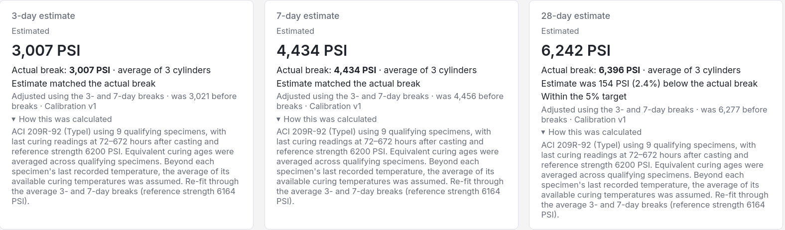
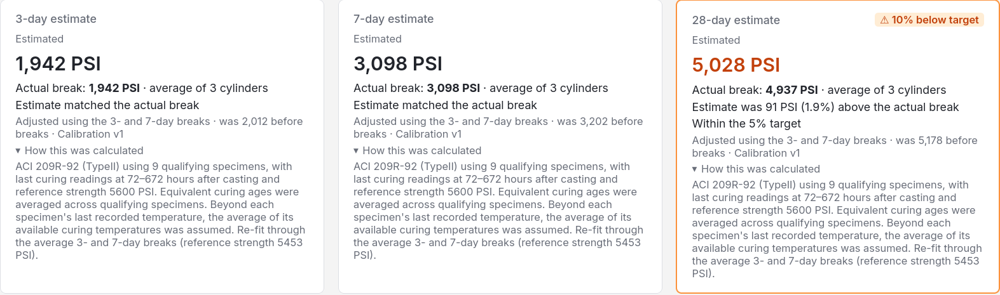
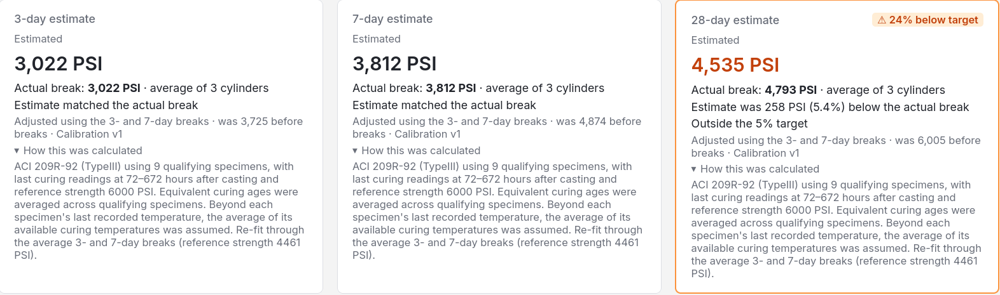
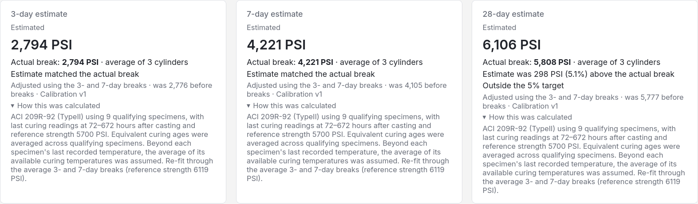
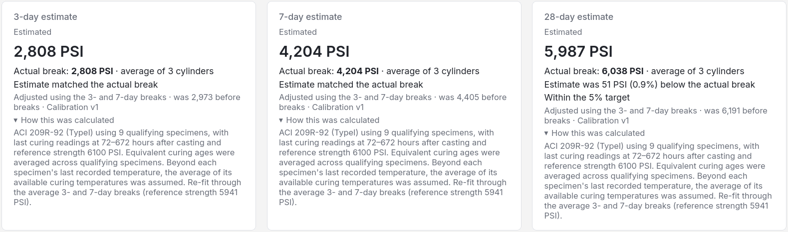
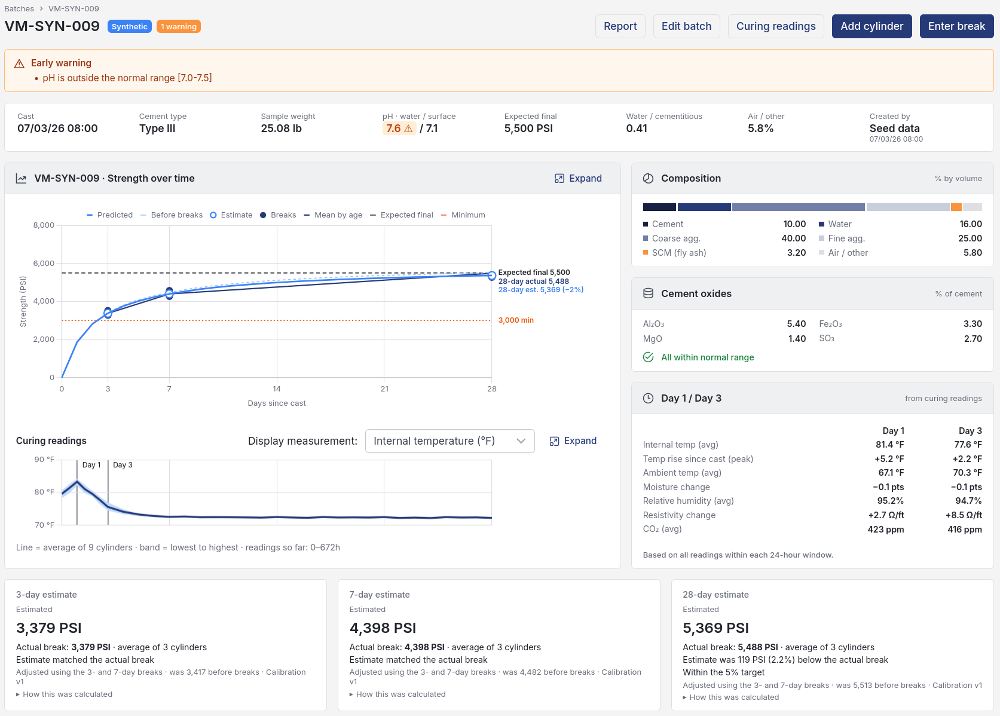

# Validation Report

How break prediction accuracy was measured, on what data, outcomes, and relevance.

## Method

In accordance with client feedback (see Client Decisions 14.2), we classify accurate measurements as those within 5% of the expected final break PSI for the batch.

## Data

Our results are over synthetic data that we have generated. Synthetic data was used over real Vulcan Materials data due to us not being provided with real data.

## Results

Results are shown by synthetic batch. Screenshots are from the real interface.

Overall, synthetic batches 1, 4, 5, 7, 8, and 9 are within the 5% threshold. Meanwhile synthetic batches 2, 3, and 6 are outside of this range. As a whole, the usage of synthetic data verifies that our prediction engine works, but whether it is reliable enough for real usage depends on testing over real data (see [Limitations](#limitations)).

### VM-SYN-001

### VM-SYN-002

### VM-SYN-003

### VM-SYN-004

### VM-SYN-005

### VM-SYN-006

### VM-SYN-007

### VM-SYN-008

### VM-SYN-009

## Limitations

As stated in Section 1.3 of the SLA, synthetic data does not establish accuracy nor reliability of strength estimates when applied to real-world batches. Synthetic data had to be used in place of real data due to unavailability of real Vulcan Materials data. Real data must be used to validate the prediction engine to ensure accuracy.

## Next Steps

To test the accuracy of predictions against real data, real data can be entered through the desktop interface. Once a batch is entered with a cylinder and at least one curing reading taken after 24h, predictions begin to be calculated. Before then, there is not enough data for prediction. Continuing to add curing readings and break results for cylinders changes predictions.

Predictions are viewed on the batch overview page and include a strength over time graph, a graph of curing readings over time, and numerical prediction results for 3, 7, and 28 day estimates. Below is an example from VM-SYN-009.

